# Modelo conceitual

Sem tipos, sem chaves técnicas. Só entidades, o que identifica cada uma e como se relacionam.
Cardinalidade declarada nas duas pontas, sempre.

```mermaid
erDiagram
    ADMIN_USER      ||--o{ ADMIN_SESSION        : "abre 0..N sessões"
    ADMIN_USER      ||--o{ CONFIG_CHANGE_AUDIT  : "assina 0..N alterações"
    ADMIN_USER      ||--o{ API_KEY              : "cria 0..N chaves"
    ADMIN_USER      ||--o{ AUTH_ATTEMPT         : "tenta entrar 0..N vezes"

    CONFIG_OVERRIDE ||--o{ CONFIG_CHANGE_AUDIT  : "sofre 0..N alterações"

    API_KEY         ||--|{ API_KEY_SCOPE        : "tem 1..N escopos"

    META_CONNECTION ||--|{ META_CONNECTION_SCOPE : "recebe 1..N escopos"
    META_CONNECTION ||--o{ META_ASSET           : "autoriza 0..N objetos"
    META_CONNECTION ||--o{ META_TOKEN           : "guarda 0..N tokens"
    META_ASSET      |o--o{ META_TOKEN           : "usa 0..N tokens"
    META_ASSET      |o--o{ META_ASSET           : "Página-mãe de 0..N IG/ad accounts"
    META_TOKEN      ||--o{ META_TOKEN_EVENT     : "registra 0..N eventos"
    META_ASSET      |o--o{ META_WEBHOOK_EVENT   : "é alvo de 0..N eventos"
    META_ASSET      ||--o{ META_USAGE_HOURLY    : "consome 0..N janelas"

    META_ASSET      |o--o{ PROFILE_SNAPSHOT         : "produz 0..N snapshots de audiência"
    META_ASSET      ||--o{ PROFILE_INSIGHT_SNAPSHOT : "produz 0..N métricas de período"
    META_ASSET      ||--o{ META_POST_SNAPSHOT       : "produz 0..N snapshots de publicação"
    META_ASSET      ||--o{ AD_INSIGHT_SNAPSHOT      : "produz 0..N linhas de anúncio"

    ADMIN_USER {
        texto identificador
        texto login_unico
    }
    ADMIN_SESSION {
        texto hash_do_token
        instante expira_em
    }
    AUTH_ATTEMPT {
        instante tentado_em
        texto ip
    }
    CONFIG_OVERRIDE {
        texto chave_do_campo
        texto valor_serializado
    }
    CONFIG_CHANGE_AUDIT {
        instante alterado_em
        texto chave_do_campo
        texto valor_anterior
        texto valor_novo
    }
    API_KEY {
        texto prefixo_visivel
        texto hash_da_chave
    }
    API_KEY_SCOPE {
        texto escopo
    }
    META_CONNECTION {
        texto id_do_usuario_facebook
        texto status
    }
    META_CONNECTION_SCOPE {
        texto escopo
    }
    META_ASSET {
        texto tipo
        texto id_externo
    }
    META_TOKEN {
        texto tipo_de_token
        binario texto_cifrado
        instante expira_em
    }
    META_TOKEN_EVENT {
        texto evento
        instante ocorrido_em
    }
    META_WEBHOOK_EVENT {
        texto chave_de_deduplicacao
        texto status
        instante recebido_em
    }
    META_USAGE_HOURLY {
        instante inicio_da_hora
        texto grupo_de_chamada
    }
    PROFILE_SNAPSHOT {
        instante capturado_em
        texto plataforma
        texto handle
        texto origem
    }
    PROFILE_INSIGHT_SNAPSHOT {
        texto metrica
        inteiro valor
        instante periodo_inicio
        instante periodo_fim
    }
    META_POST_SNAPSHOT {
        texto id_externo_da_publicacao
        instante capturado_em
    }
    AD_INSIGHT_SNAPSHOT {
        texto nivel
        texto id_externo_da_entidade
        data data_inicio
        data data_fim
        inteiro gasto_em_unidade_minima
    }
```

## Leitura das cardinalidades que costumam errar

- **`META_ASSET |o--o{ META_ASSET`** (Página → Instagram / conta de anúncios): o Instagram profissional existe vinculado a uma Página; a conta de anúncios é independente. Por isso `0..1` do lado pai (conta de anúncios não tem pai) e `0..N` do lado filho. Se o vínculo mudar no site da Meta, é atualização de atributo, não nova conta.
- **`META_CONNECTION ||--o{ META_ASSET`**: uma autorização OAuth pode dar acesso a várias Páginas. Se o mesmo objeto for autorizado por dois usuários diferentes, é **outra** conexão apontando para o mesmo `(asset_type, external_id)` — o que a unicidade impede hoje. Decisão de multi-tenant define se a unicidade passa a incluir o cliente.
- **`API_KEY ||--|{ API_KEY_SCOPE`**: chave sem escopo é chave que não serve para nada; mínimo 1.
- **`META_ASSET |o--o{ PROFILE_SNAPSHOT`**: scraping não tem conta Meta. O snapshot existe sem `meta_asset_id`; por isso `0..N` e não `1..N`.
- **`META_WEBHOOK_EVENT`** aponta para o objeto atingido quando ele for conhecido (`0..1` do lado do evento). Objeto desconhecido é aceito, gravado e descartado — o evento não depende de a conta existir.
- **`CONFIG_OVERRIDE ||--o{ CONFIG_CHANGE_AUDIT`**: auditoria sobrevive ao override removido. O vínculo é lógico (pela chave), não FK — por isso a auditoria repete a chave e o nome do autor.
