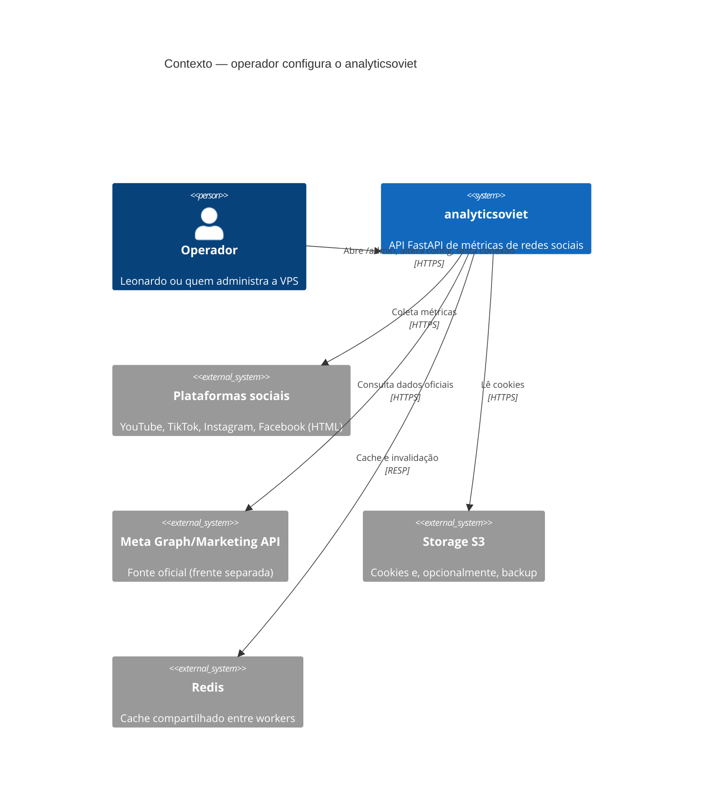
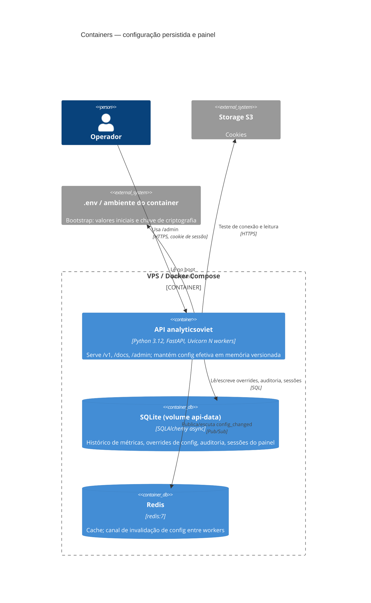
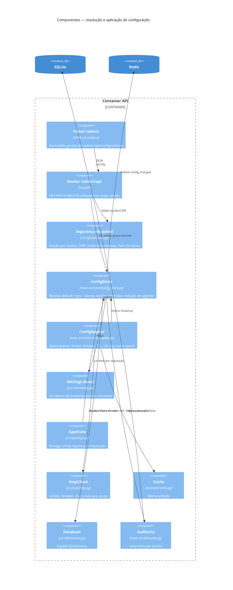

# Arquitetura — Painel de configuração (/admin)

**Pergunta que responde:** como o operador altera os ~50 campos de `Settings` pela web, sem editar `.env` e sem reiniciar o container, sem que dois workers fiquem com configurações diferentes e sem expor segredo.

**Escopo:** issues #2 (épico), #3, #4, #5, #6, #7. Não cobre autenticação de `/v1/*` (issue #13).

**Fatos do código que restringem o desenho**
- `src/core/config.py`: `Settings(BaseSettings)` + `get_settings()` com `@lru_cache(maxsize=1)`. O objeto é imutável na prática: ninguém recarrega.
- `src/main.py` (`lifespan`): `Database.start()` só roda se `enable_history` for verdadeiro (`src/db/session.py`, propriedade `enabled`). Sem histórico, não há banco — e a configuração persistida não teria onde morar.
- `src/api/deps.py`: `AppState` e `AdapterContext` guardam o **mesmo** objeto `Settings` para sempre. `HttpClient`, `Cache`, `PlatformLimiter`, `CircuitBreaker` e cada adapter leem valores no construtor ou no primeiro uso.
- `src/core/cache.py`: `MemoryCache(max_entries=...)` é criado no boot; `RedisCache` também. Trocar backend exige processo novo.
- `src/core/http.py`: `httpx.AsyncClient` é criado em `start()` com timeout, limits e `proxy` fixos. Só existe `aclose()`, não existe reconstrução.
- `src/core/ratelimit.py`: `PlatformLimiter` cria bucket e semáforo **lazy**, na primeira chamada por plataforma, a partir de `settings.ratelimit_for()`.
- `src/core/breaker.py`: `CircuitBreaker` recebe limiar e cooldown no construtor.
- `Dockerfile`: `uvicorn ... --workers ${WEB_CONCURRENCY}`. Cada worker é um processo com seu próprio `lifespan`, seu próprio `AppState` e seu próprio cache em memória.
- `src/api/docs.py`: padrão a seguir para servir UI (assets locais, sem CDN).

---

## C4 nível 1 — contexto



## C4 nível 2 — containers



**Donos:** API = time de implementação; SQLite = modelo de dados (`src/db/`); Redis = infra do compose.

## C4 nível 3 — componente do subsistema de configuração

É o único ponto com dúvida real: quem lê o quê, e quando.



---

## Modelo de configuração

### Precedência
`default do campo` < `ambiente/.env` < `override no banco`. Um único ponto resolve: `ConfigStore.snapshot()` devolve um `EffectiveSettings` (mesmo contrato de `Settings`, construído por validação pydantic sobre o dicionário final, nunca por mutação do objeto).

Campos `read_only` aceitam override **apenas** por ambiente: `database_url`, `api_prefix`, `environment`, `app_version`, `cache_backend`, `redis_url`, backend e caminhos de cookies.

### Classificação (define o que a issue #6 precisa detalhar por campo)

| Classe | Significado | Campos |
|---|---|---|
| **quente** | vale na requisição seguinte, sem tocar em recurso de rede | 5 TTLs de cache, 4 `ratelimit_*`, 4 `concurrency_*`, `breaker_enabled/threshold/cooldown`, `scrape_max_urls`, `scrape_default_posts`, `enable_ytdlp_fallback`, `log_level`, `user_agents`, `youtube_api_key`, campos Meta de quota |
| **quente com reconstrução** | exige novo `httpx.AsyncClient`, mas sem reiniciar processo | `proxy_url`, `http_timeout_seconds`, `http_connect_timeout_seconds`, `http_max_connections`, `http_max_keepalive_connections` |
| **fria** | exige processo novo | `database_url`, `api_prefix`, `environment`, `cache_backend`, `redis_url`, `enable_history`, `cookies_storage_backend`, `cookies_dir`, `cookies_*_file`, todos os `s3_*`, `public_base_url` |
| **somente leitura** | override recusado com 422 | `app_name`, `app_version` |

Decisão sobre proxy/timeout: ver ADR-0002. Nesta entrega, `proxy_url` e timeouts entram como **frios**, com selo "exige reinício" na tela — é a opção que não expõe requisição em voo a cliente fechado.

### Segredos
`S3_SECRET_ACCESS_KEY`, `S3_ACCESS_KEY_ID`, `S3_SESSION_TOKEN`, `YOUTUBE_API_KEY`, `META_APP_SECRET`, `META_TOKEN_ENCRYPTION_KEY`.
- Não podem ser gravados em claro. Cifrados com chave simétrica vinda do ambiente (`CONFIG_SECRET_KEY`); sem essa chave, override de segredo é **recusado** (não cai para texto puro).
- Leitura devolve `{"is_set": true, "value": null}`; nunca o valor, nunca o hash.
- Envio de `"***"` ou `null` = "não mexe".
- Auditoria grava `"alterado"` e o tamanho, não o conteúdo.

### Versão e multi-worker
Uma linha `config_version` (inteiro) é incrementada em toda escrita. Cada worker mantém o snapshot em memória e:
- com `CACHE_BACKEND=redis`: assina `config_changed` e recarrega em milissegundos;
- sem Redis: consulta a versão no banco no máximo **1×/s** (uma linha, índice por PK), com o valor já carregado em cache entre consultas.

`--workers N` significa N cópias do `lifespan`: nada de goroutine única assumida — a invalidação é por versão no banco, não por memória compartilhada.

---

## Fluxos

### Escrita (PATCH /admin/api/config) com validação atômica

```mermaid
sequenceDiagram
    autonumber
    participant B as Navegador (/admin)
    participant S as Router /admin/api
    participant C as ConfigStore
    participant V as Validator (pydantic)
    participant D as SQLite
    participant A as ConfigApplier

    B->>S: PATCH { campo: valor, ... } + cookie + CSRF
    S->>S: sessão válida? CSRF ok?
    alt sessão inválida
        S-->>B: 401 (corpo vazio, sem campos)
    end
    S->>C: proposta (atual + diff)
    C->>V: monta EffectiveSettings completo
    alt inválido
        V-->>S: erros por campo
        S-->>B: 422 {campo, motivo}; nada gravado
    end
    C->>D: BEGIN; upsert overrides; version+1; auditoria; COMMIT
    alt falha no banco
        D-->>C: erro
        C-->>S: 503 config_write_failed
        S-->>B: 503; configuração anterior mantida
    end
    C->>A: notify(versão, diff)
    A->>A: aplica quente + marca frios como pendentes
    S-->>B: 200 {efetivo, diff, requires_restart[]}
```

Regras: escrita é tudo-ou-nada; a resposta devolve o **valor efetivo** (não o enviado); campo frio alterado entra como pendência visível, nunca é aplicado silenciosamente.

### Aplicação a quente

| Componente | Como passa a ler o valor novo |
|---|---|
| `PlatformLimiter` | bucket e semáforo reconstruídos no `notify`; requisição em voo termina no semáforo antigo |
| `CircuitBreaker` | limiar/cooldown viram atributos lidos na chamada; `breaker_enabled` desligado limpa estado |
| `Cache` | TTL é lido no `set`; ver "janela de TTL" abaixo |
| `HttpClient.user_agent` | mapa `_ua_by_platform` limpo no `notify` |
| adapters | passam a ler `ctx.config.current()` em vez de `ctx.settings.*` |
| structlog | `configure_logging` chamado de novo |

**Janela de TTL (furo na issue #5):** diminuir `cache_ttl_profile_seconds` não encurta entrada já gravada — o TTL está no próprio item. Critério "muda na requisição seguinte" só é verdade para chave nova. Solução adotada: `ConfigStore` expõe `cache_epoch`; as chaves de `src/platforms/base.py` (`cache_key()`) recebem o epoch da **família de TTL** (perfil/posts/post/bloqueado). Mudar um TTL incrementa só o epoch daquela família, o que invalida na prática as entradas antigas sem varrer nada. Custo: perde cache quente naquela família — aceitável e explícito.

### Leitura na requisição
`StateDep` continua sendo o ponto único. `AppState` ganha `config: ConfigStore` e um método `settings` que devolve o snapshot vigente. Nada fora de `deps.py` chama `get_settings()` diretamente; `get_settings()` permanece só para o bootstrap (e para testes).

---

## Pontos de integração (arquivo por arquivo)

| Arquivo | Mudança de desenho |
|---|---|
| `src/main.py` | `lifespan`: ordem passa a ser ConfigStore → DB → HttpClient → Cache → componentes Meta → `AppState`. Registrar routers `admin` e `admin_api` fora de `api_prefix`. No shutdown, fechar applier e store. |
| `src/main.py` | `create_app`: montar `/admin` e `/admin-assets` no padrão `install_docs`; `openapi_tags` ganham `admin`; admin **não** entra no `/openapi.json` público além do mínimo (ver ADR-0003). |
| `src/api/deps.py` | `AppState` ganha `config`; nova dependência `require_admin`; `build_state` recebe o ConfigStore. |
| `src/core/config.py` | `Settings` continua existindo como base (env). Campos novos: `admin_enabled`, `admin_password_hash`, `admin_session_ttl_seconds`, `config_secret_key`, `config_reload_seconds`. `get_settings()` deixa de ser o caminho de runtime. |
| `src/db/session.py` | separar "banco de histórico" de "banco de configuração": o engine sobe **sempre**, e `record_result` continua respeitando `enable_history`. Sem isso, `ENABLE_HISTORY=false` mata os overrides. |
| `src/db/models.py` | novas tabelas de override, auditoria e sessão (modelagem é do Modelador de Dados; aqui só a necessidade). |
| `src/core/ratelimit.py` | construtor recebe um `Callable[[], EffectiveSettings]` em vez do objeto fixo. |
| `src/core/cache.py` | `MemoryCache.max_entries` mutável; `stats()` passa a informar epoch. |
| `src/core/http.py` | expor `apply_settings(effective)` para limiter/breaker/UA; proxy/timeout ficam para o restart. |
| `src/platforms/base.py` | `AdapterContext` recebe `config`; `cached()` lê TTL e epoch do snapshot. |
| `docker-compose.yml` | variáveis novas só via `env_file`/ambiente; `CONFIG_SECRET_KEY` e `ADMIN_PASSWORD_HASH` fora do banco. |

---

## Autenticação e auditoria (fecha #4)

- Um único operador nesta entrega (decisão ADR-0004). Hash de senha em variável de ambiente (`ADMIN_PASSWORD_HASH`), nunca no banco; algoritmo definido pelo Tech Lead (argon2id ou scrypt).
- Sessão: cookie `HttpOnly`, `Secure` quando `environment=prod` e TLS terminado no proxy, `SameSite=Lax`, TTL absoluto; tabela de sessão permite logout e revogação.
- CSRF: token por sessão em header `X-CSRF-Token`; escrita sem token = 403.
- Força bruta: limite por IP em memória + registro de falha; após N falhas, bloqueio temporário. IP vem de `X-Forwarded-For` **apenas** porque o uvicorn roda com `--proxy-headers` e o proxy é confiável.
- Auditoria: uma linha por transação de escrita, com usuário, IP, campo, origem anterior, valor anterior, valor novo (segredo = `"alterado"`), versão resultante.

---

## Riscos e atributos de qualidade

| # | Risco | Mitigação | Número |
|---|---|---|---|
| 1 | Divergência de config entre workers | versão no banco + reload ≤1 s | convergência ≤ 1 s |
| 2 | Escrita parcial corrompe estado | transação única + validação do objeto completo | 0 escrita parcial |
| 3 | Segredo em log/resposta | redação no serializer e no logger; teste percorre todas as respostas | 0 ocorrência |
| 4 | Override quebra o boot | validação no boot; falha de banco → sobe com env+default | boot ≤ 5 s mesmo com banco fora |
| 5 | SQLite com N workers | leitura curta; escrita rara; WAL habilitado | escrita < 50 ms |
| 6 | Cache perdido a cada mudança de TTL | epoch por família de TTL | perda limitada à família |
| 7 | Painel exposto | `/admin` desligável (`ADMIN_ENABLED=false`) e 401 sem sessão | 0 campo vazado |

---

## Decisões fechadas (seção "Aberto" das issues)

| Issue | Item aberto | Decisão de arquitetura | Alternativa descartada |
|---|---|---|---|
| #2 / #6 | Senha única por ambiente ou usuário no banco | **Senha única no ambiente** nesta entrega; modelo de usuário só se aparecer segundo operador | Tabela `users` já agora: sem requisito, aumenta superfície |
| #2 / #6 | Onde persistir | **SQLite existente**, tabela de override, WAL ligado | Arquivo versionado: não é atômico entre workers, conflita com o volume |
| #2 / #6 | Segredo no banco ou só `.env` | **Cifrado no banco com chave do ambiente**; sem chave, segredo permanece só no `.env` e a tela mostra "definido no ambiente" | Só presença: impede testar credencial nova sem restart |
| #2 / #4 | `/admin` na mesma porta ou separada | **Mesma porta e domínio**, caminho `/admin`, cookie com `Path=/admin` | Porta separada: dobra o proxy e o certificado |
| #3 | Prefixo `/admin/api` ou `/v1/admin` | **`/admin/api`**, fora de `api_prefix` | `/v1/admin`: mistura contrato público com administrativo |
| #3 | Teste de conexão escreve? | **Só leitura** (list/head no S3, PING no Redis, chamada barata na API) | Escrita de teste: altera dado do cliente |
| #5 | Recriar `HttpClient` em runtime | **Não nesta entrega**; proxy e timeouts são frios | Recriar: requisições em voo com cliente fechado |
| #5 | TTL muda e entrada antiga permanece | **Epoch por família de TTL** | Varrer chaves: Redis sem SCAN seguro em produção |
| #7 | Tema escuro | **Não**; layout claro, uma coluna até 720 px | Tema: custo sem requisito |
| #7 | Quem opera | **Só o operador** (Leonardo) nesta entrega | Multi-cliente: exige multi-tenant na config |

---

## Correções que a especificação deve incorporar

1. **#6 — banco sempre no boot.** `Database.start()` está condicionado a `enable_history`; a config persistida não pode depender disso.
2. **#5 — critério de TTL.** "Muda na requisição seguinte" só vale com epoch/invalidação; o critério atual é não testável como escrito.
3. **#5 — concorrência.** Teste "troca durante requisições em voo" precisa de semáforo antigo drenando; definir que a requisição em voo termina com a config com que começou.
4. **#4 — TLS.** `Secure` e `X-Forwarded-For` dependem do proxy do Coolify; sem essa confirmação, cookie `Secure` só com `environment=prod` e `public_base_url` https.
5. **#3 — OpenAPI.** "Documentação do painel aparece em `/docs`" expõe rota administrativa no contrato público; recomendo `include_in_schema=false` em `/admin/api` e documento separado.
