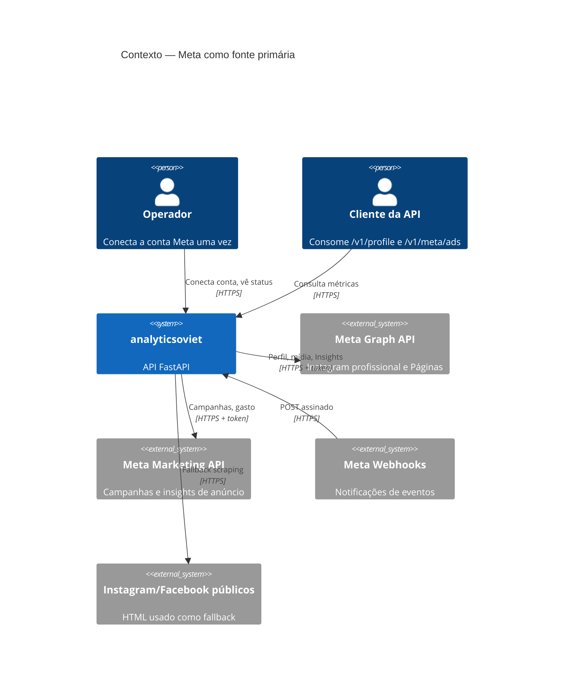
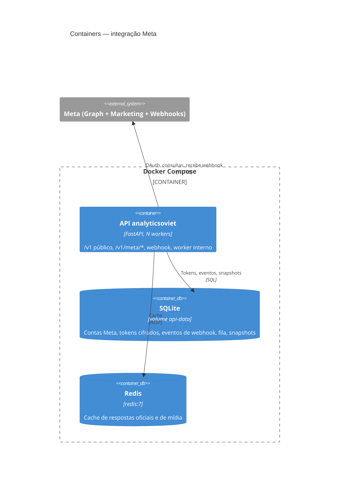
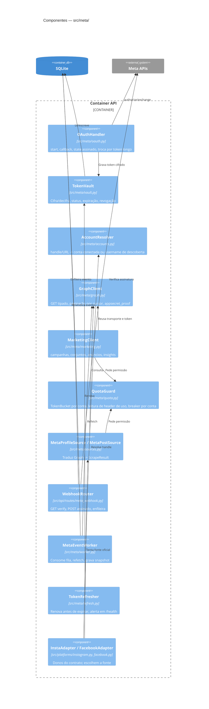
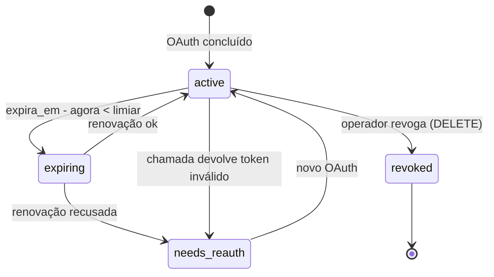

# Arquitetura — Integração oficial com a Meta (Graph + Marketing)

**Pergunta que responde:** como Instagram e Facebook passam a ter a Graph API como fonte primária, com OAuth, token de longa duração, Insights, Marketing API e webhooks, sem quebrar o contrato de `src/models/schemas.py` e sem perder o scraping como rede de segurança.

**Escopo:** issues #1 (épico), #10, #8, #12, #9, #11. Fatos da Meta (versão, permissões, tipos de token, quota, App Review) são do MetaNO; aqui só se desenha em cima deles.

**Fatos do código que restringem o desenho**
- `src/platforms/registry.py`: o registro é `{Platform: adapter}`. **Um adapter por plataforma.** Criar um "MetaAdapter" para `instagram` colide com o HTML e `registry.get("instagram")` passa a devolver um ou outro.
- `src/models/schemas.py`: `Source` já tem `official_api`; `Profile.extra`/`Post.extra` existem para campos sem slot canônico; ausência é `null` + `warnings`, nunca zero.
- `src/core/errors.py`: contrato de erro fechado (código + `http_status` + `retryable` + `detail`).
- `src/main.py`: `lifespan` único por **worker** (`--workers ${WEB_CONCURRENCY}`), então rotina de fundo roda N vezes se não houver eleição.
- `src/db/session.py`: banco só sobe com `enable_history` — o cofre de tokens não pode depender disso.
- `src/api/docs.py` / `docker-compose.yml`: só uma porta pública (`8008:8000`), healthcheck em `/v1/health`.

---

## C4 nível 1 — contexto (frente Meta)



## C4 nível 2 — containers



## C4 nível 3 — componentes do subsistema Meta



---

## Decisão central: fonte, não adapter

`InstagramAdapter` e `FacebookAdapter` continuam sendo **os** adapters de `instagram` e `facebook`. A Graph API entra como uma **fonte** injetada em `AdapterContext`, com o mesmo formato de retorno:

```
fetch_profile():
  se existe conta conectada e token válido e handle pertence a ela:
      tenta MetaProfileSource  -> ScrapeResult(source=official_api, confidence=high)
      se falhar: registra warning e segue
  executa o caminho HTML atual -> ScrapeResult(source=html, confidence=medium/low)
  se a fonte oficial falhou, acrescenta warning "meta_graph_unavailable: <motivo>"
```

Consequências:
- `detect()` e o registro não mudam; URL, cache key e contrato ficam idênticos.
- `source` continua `official_api` (já documentado em `src/api/docs.py` e no enum). O provedor vai em `extra` (`extra.provider = "meta_graph"`), evitando quebrar cliente que compara `source`.
- `confidence=high` só quando o dado vem da Meta; fallback mantém a confiança do HTML.
- Nenhum campo novo vira zero: Insights ausente é `null` + warning.

**Limite de escopo que a issue #8 não diz:** Insights existem para contas que o token administra. Para perfil de terceiro, a Graph só serve se o MetaNO confirmar *Business Discovery* (username de conta profissional) e os campos permitidos. O desenho trata os dois casos, mas o comportamento é decidido por capacidade, não por suposição:

| Situação do handle | Fonte tentada |
|---|---|
| Conta própria conectada | Graph completa (perfil, mídia, Insights) |
| Conta de terceiro, Business Discovery confirmado | Graph limitada (campos da lista do MetaNO) |
| Terceiro sem descoberta | Só HTML atual |

---

## Fluxo OAuth (issue #10)

```mermaid
sequenceDiagram
    autonumber
    participant B as Navegador do operador
    participant A as API (/v1/meta/oauth)
    participant M as Meta
    participant V as TokenVault
    participant D as SQLite

    B->>A: GET /v1/meta/oauth/start (sessão do painel)
    A->>D: grava state (nonce, exp, conta solicitante)
    A-->>B: 302 para authorize?client_id&redirect_uri&scope&state
    B->>M: autoriza
    M-->>A: GET /v1/meta/oauth/callback?code&state
    A->>D: state existe, não usado, não expirado?
    alt state inválido/expirado/repetido
        A-->>B: 400 oauth_state_invalid (nada gravado)
    end
    A->>M: troca code por token curto
    A->>M: troca por token longo
    A->>M: /me/accounts (Páginas + page tokens)
    A->>M: página -> instagram_business_account
    alt nenhuma Página/IG profissional
        A->>D: registra tentativa; nada conectado
        A-->>B: 200 conectado=false, motivo "sem conta profissional"
    end
    A->>M: chamada de teste /me e /{ig-id}
    alt teste falha
        A-->>B: 502 meta_unreachable; token não é salvo
    end
    A->>V: cifra e grava token + escopos + expiração + conta
    V->>D: INSERT conta/token, status=active
    A-->>B: 302 /admin/meta?conectado=1
```

Regras de desenho:
- `state` é aleatório, assinado (HMAC com `CONFIG_SECRET_KEY`) **e** de uso único no banco. Assinatura sozinha não impede replay.
- `code` nunca é logado; parâmetros sensíveis saem da URL de callback logo após o uso.
- Escopo efetivamente concedido é lido da resposta e gravado; permissão faltante vira `warnings` na tela, não erro genérico.
- Token em repouso: cifrado (AES-GCM ou Fernet; chave em `META_TOKEN_ENCRYPTION_KEY`, nunca no banco). Guarda-se também o hash do token para detectar troca sem decifrar em lote.
- Renovação: rotina diária verifica expiração; renova o que a Meta permitir; falha → `status=needs_reauth` e alerta em `/v1/health`.

### Estados do token



`needs_reauth` nunca derruba o serviço: o adapter cai para HTML e `/v1/health` mostra a conta.

---

## Fluxo de leitura com fallback (issue #8)

```mermaid
sequenceDiagram
    autonumber
    participant C as Cliente
    participant R as Router /v1/profile
    participant AD as InstagramAdapter
    participant AC as AccountResolver
    participant Q as QuotaGuard
    participant G as GraphClient
    participant H as Caminho HTML atual

    C->>R: GET /v1/profile/instagram/{handle}
    R->>AD: fetch_profile()
    AD->>AC: handle -> conta conectada?
    alt conta conectada e token ativo
        AD->>Q: acquire(conta)
        alt quota/breaker da conta bloqueia
            Q-->>AD: MetaRateLimited
            AD->>AD: warning "meta_quota_exceeded"
            AD->>H: scraping
        else permitido
            AD->>G: perfil + mídia + insights (fields explícitos)
            alt 200 com dados
                G-->>AD: payload
                AD-->>R: ScrapeResult(official_api, high)
            else erro de permissão (não retentável)
                G-->>AD: MetaPermissionError
                AD->>AD: warning "meta_permission: <campo>"
                AD->>H: scraping
            else 5xx/timeout (retentável)
                G-->>AD: erro
                AD->>AD: backoff; breaker da conta registra falha
                AD->>H: scraping
            end
        end
    else sem conta
        AD->>H: scraping
        AD->>AD: warning "meta_not_connected"
    end
    AD-->>C: resultado com source, confidence e warnings
```

Cache: a chamada oficial usa TTL próprio (`meta_cache_ttl_seconds`), separado do TTL de scraping — quota é o recurso escasso. Chave inclui conta e janela de Insights.

---

## Insights no contrato

Insights não cabem em `ProfileMetrics` (audiência) nem em `PostMetrics` (contadores do post). Proposta ao contrato:

```
ScrapeResult.insights: InsightsBlock | None
InsightsBlock:
  period: {since, until, preset}
  reach, impressions, profile_views, accounts_engaged: int | None
  saves, shares, video_views: int | None
  audience: dict | None   # demografia, só quando pedida
  provider: "meta_graph"
  account_id: str
```
`null` onde a Meta não entrega para aquele tipo de conta, com `warnings`. Nada de zero. `DerivedMetrics` continua calculado igual; só ganha indicadores que usem `reach` quando ele existir.

---

## Webhooks (issue #9)

```mermaid
sequenceDiagram
    autonumber
    participant M as Meta
    participant W as POST /v1/meta/webhook
    participant Q as Fila (SQLite)
    participant K as MetaEventWorker

    M->>W: POST corpo bruto + X-Hub-Signature-256
    W->>W: lê bytes crus (antes do JSON) e limita tamanho
    W->>W: HMAC-SHA256(app_secret, corpo) == header?
    alt assinatura inválida
        W-->>M: 401; nada gravado
    end
    W->>Q: INSERT evento (id único) se ainda não existe
    W-->>M: 200 em < 1 s
    K->>Q: reivindica lote (UPDATE ... WHERE status='pending')
    K->>M: GET objeto atualizado (Graph)
    K->>K: grava snapshot com source=meta_webhook
    alt falha retentável
        K->>Q: tenta de novo com backoff até o limite
    else falha permanente
        K->>Q: status='dead' + log
    end
```

Decisões:
- **Verificação** (`GET`) compara `hub.verify_token` em tempo constante e devolve `hub.challenge` só com o token certo; erro = 403 sem corpo.
- **Assinatura** sobre o corpo **cru**: em FastAPI, `await request.body()` antes de qualquer parsing; corpo > 512 KB recusado com 413.
- **Idempotência** por `(app_id, object, event_id)` único no banco; evento repetido responde 200 e não grava.
- **Fila em SQLite**, não em Redis: sobrevive a restart sem depender de AOF, e o volume é baixo (eventos de conta própria). Redis fica só como cache.
- **Worker com eleição**: com `WEB_CONCURRENCY > 1`, só o worker que obtém o lock de líder (linha com heartbeat no SQLite) processa fila e renova token. Os demais não iniciam a rotina.
- `source` do snapshot: o enum `Source` não tem `meta_webhook`; usar `official_api` + `extra.origin="meta_webhook"` para não expandir o contrato.

---

## Marketing API (issue #12)

- Router próprio `/v1/meta/ads/*`, somente `GET`, autenticado pelo mesmo cofre.
- Campos explícitos sempre; proibido `fields=*`. Cada endpoint tem lista fechada de campos, definida com o MetaNO.
- Paginação por cursor interno: máximo de páginas e de tempo total; ao estourar, devolve `truncated=true` e o cursor — nunca lista incompleta silenciosa.
- Moeda e fuso vêm da conta de anúncio (`GET /act_{id}`), ecoados na resposta; não se força `America/Sao_Paulo` (senão gasto e data não batem com o Gerenciador).
- Cache curto por `(conta, nível, período, campos)`; invalidação manual por `POST`? Não: endpoint de cache é `DELETE /v1/meta/ads/cache` — leitura de dados continua read-only.
- Insights de anúncio não entram em `ProfileSnapshot`; vão para tabela própria (Modelador de Dados).

---

## Quota, erros e observabilidade (issue #11)

**Quota:** `QuotaGuard` reaproveita `TokenBucket` de `src/core/ratelimit.py`, com chave = conta Meta (não plataforma). Limite inicial conservador e ajustável; se o header de uso da Meta vier e indicar consumo alto, o guard reduz a taxa antes do bloqueio. Nomes exatos dos headers: a confirmar com MetaNO.

**Breaker:** instância separada, chave = conta. Conta bloqueada não abre o breaker de `instagram`/`facebook` do scraping — são recursos diferentes e punir o HTML por erro de token seria errado.

**Tradução de erro** (preserva o contrato de `src/core/errors.py`):

| Erro Meta | Código no contrato | HTTP | Retenta | `detail.meta` |
|---|---|---|---|---|
| token inválido/expirado | `auth_required` | 401 | não | code, subcode, fbtrace_id |
| permissão ausente | `auth_required` (ou `forbidden` se o Tech Lead criar) | 403 | não | campo, escopo faltante |
| limite de chamadas | `rate_limited` | 429 | sim | usage, retry_after |
| objeto inexistente | `not_found` | 404 | não | objeto, id |
| erro interno Meta | `upstream_error` | 502 | sim | code, fbtrace_id |
| conta em breaker | `circuit_open` | 503 | sim | conta |

Quando a falha vem da fonte oficial mas o scraping ainda entrega dado, **o cliente não recebe erro**: recebe `200` com `warnings` e `source=html`. Erro só sobe quando as duas fontes falham.

**Observabilidade:** `/v1/health` ganha bloco aditivo `meta`: por conta → `status`, `expira_em_dias`, `chamadas_na_janela`, `breaker`, `ultimo_erro` (sem token). Log estruturado com `account_id`, `endpoint`, `meta_code`, `fbtrace_id`, latência. Filtro de redação para `access_token`, `appsecret_proof`, `Authorization`, `code`.

---

## Pontos de integração (arquivo por arquivo)

| Arquivo | Mudança |
|---|---|
| `src/main.py` | `lifespan`: DB → ConfigStore → TokenVault → MetaClient/QuotaGuard → `AdapterContext` com `meta` → routers → worker/refresher (só líder). Shutdown na ordem inversa, com drenagem do worker. |
| `src/main.py` | `include_router(meta_oauth)` e `include_router(meta_ads)` em `api_prefix`; `meta_webhook` **sem** dependência de sessão e com handler de erro próprio. |
| `src/api/deps.py` | `AppState.meta` (opcional); dependência `require_meta_account` para rotas de anúncio; `AdapterContext` recebe `meta`. |
| `src/platforms/instagram.py`, `facebook.py` | escolha de fonte no início de `fetch_profile`/`fetch_post`; nenhuma mudança em `detect()`. |
| `src/platforms/base.py` | `AdapterContext.meta: MetaAccess | None`; helper comum de fallback e warning. |
| `src/models/schemas.py` | `InsightsBlock`, campo `insights` em `ScrapeResult`, resumo `meta` em `HealthResponse`, `truncated`/`cursor` nas respostas de anúncio. |
| `src/core/errors.py` | subclasses `MetaAuthError`, `MetaPermissionError`, `MetaRateLimitError` mapeadas para os códigos existentes. |
| `src/core/config.py` | `meta_app_id`, `meta_app_secret`, `meta_graph_version`, `meta_redirect_uri`, `meta_verify_token`, `meta_token_encryption_key`, `meta_insights_window_days`, `meta_quota_*`, `meta_cache_ttl_seconds`, `meta_enabled`. |
| `src/db/models.py` | contas, tokens cifrados, escopos, eventos de webhook, fila, snapshots de anúncio (modelagem: Modelador de Dados). |
| `src/db/session.py` | engine sempre ativo (idem frente admin): cofre não depende de `enable_history`. |
| `docker-compose.yml` | `META_*` via `env_file`; nada de segredo no compose. |
| `.github/workflows/tests.yml` | testes com `respx` para Graph/Marketing; `tests/live` continua opt-in. |

---

## Riscos e atributos de qualidade

| # | Risco | Mitigação | Número |
|---|---|---|---|
| 1 | App Review negado → integração inútil | piloto só com contas próprias; escopos mínimos; feature flag `meta_enabled` | disponibilidade da fonte oficial = 0 sem bloquear API |
| 2 | Quota estourada castiga o app | guard por conta + cache + backoff | uso < 70% da quota confirmada |
| 3 | Token vazado em log | redação central + teste que varre logs | 0 ocorrência |
| 4 | Webhook lento → Meta reentrega em massa | ACK antes do processamento | p95 ACK < 200 ms, máx 1 s |
| 5 | Evento duplicado gera snapshot duplicado | unique por evento + upsert por (conta, objeto, janela) | 0 duplicado |
| 6 | Multi-worker processa fila 2× | lock de líder com heartbeat | 1 processador |
| 7 | Fallback mascara dado velho | `source` + `warnings` sempre preenchidos; TTL curto no bloqueado | 100% dos resultados com origem declarada |
| 8 | Insights de terceiros indisponíveis | capacidade declarada em `/v1/platforms` | comportamento documentado por plataforma |
| 9 | Latência do endpoint sobe | orçamento por fonte: Graph ≤ 1,2 s p95; insights 28 d ≤ 2 s p95; senão fallback | ≤ 3 s p95 total |

---

## Decisões fechadas (seção "Aberto" das issues)

| Issue | Item aberto | Decisão de arquitetura | Alternativa descartada |
|---|---|---|---|
| #1/#10 | Só contas do Leonardo ou multi-tenant | **Single-tenant**: o operador conecta as contas que o serviço representa. Multi-tenant exige isolamento por cliente em token, cache, snapshot e `/v1` — não cabe nesta entrega | Multi-tenant agora: dobra o modelo e a autorização |
| #1/#10 | App Meta já existe, tipo e produtos | **Não é decisão de arquitetura**; bloqueia só o piloto. MetaNO confirma; o desenho assume app Business com Instagram e Marketing | — |
| #1/#10 | Quem conduz App Review | Fora do código; registrar como dependência externa no plano do líder | — |
| #10 | Rotação da chave de criptografia | **Não nesta entrega**; o formato do token guarda `key_version` para permitir rotação depois | Rotação agora: sem requisito, sem operação para re-cifrar |
| #10 | Escopo de permissões | Lista fechada por endpoint, vinda do MetaNO; nada de permissão "por garantia" | Pedir tudo: aumenta rejeição no App Review |
| #8 | Instagram pessoal | **Só scraping**; a API oficial não cobre e não se inventa contorno | — |
| #8 | Janela padrão de Insights | **28 dias** (padrão da Meta), parametrizável e ecoada na resposta | 7 dias: amostra curta demais para tendência |
| #8 | `source: "meta_graph"` | **Não criar valor novo no enum**; usar `official_api` + `extra.provider` | Novo valor: quebra comparação de clientes existentes |
| #8 | Guardar Insights no histórico | **Guardar**, com `source` e janela na linha; política de plataforma a confirmar com MetaNO antes de produção | Não guardar: perde série histórica |
| #9 | Campos de webhook por conta | Assinar **feed, comments, mentions**; `messages` fica de fora (exige Messenger e revisão própria) | Tudo: aumenta superfície e revisão |
| #9 | URL pública com TLS | **Obrigatória**; usa `public_base_url` e o proxy atual, sem porta nova | — |
| #9 | Fila em banco ou Redis | **SQLite** durável + lock de líder | Redis: perde evento em restart sem AOF confiável |
| #11 | Limite conservador ou dinâmico | **Conservador com ajuste pelo header** quando o MetaNO confirmar os nomes; até lá, só conservador | Só dinâmico: depende de fato não confirmado |
| #11 | Alerta por WhatsApp | **Fora**; issue separada de outro agente. Aqui só `/v1/health` e log | — |
| #12 | Só leitura | **Sim, só `GET`**; escrita de anúncio não entra | — |
| #12 | Moeda e fuso | **Da conta de anúncio**, ecoados na resposta | Forçar São Paulo: divergência com o Gerenciador |
| #12 | Métricas do resumo | gasto, impressões, cliques, CTR, CPC, CPM e conversas iniciadas — **desde que o MetaNO confirme cada uma**; sem confirmação, ficam fora | Lista fixa sem confirmação: risco de campo inválido |

---

## O que não construir

- Segundo adapter para `instagram`/`facebook` (colide no `registry`).
- Sincronização bidirecional com a Meta, publicação de conteúdo, resposta a comentário/DM.
- Multi-tenant, painel de cliente, billing.
- Fila externa (Celery/RabbitMQ) para o volume atual.
- Cache de token em Redis: token só no cofre cifrado, decifrado em memória por chamada.
- Polling de todas as contas em intervalo curto; atualização vem de webhook + consulta sob demanda.

---

## Pontos que a especificação deve marcar como "a confirmar"

1. Versão vigente da Graph API e se Marketing usa a mesma versão.
2. Lista exata de permissões por endpoint e necessidade de App Review para cada uma.
3. Tipos de token, duração real e condição de renovação.
4. Headers de quota e limites por app/conta/Página.
5. Se *Business Discovery* cobre perfil de terceiro e quais campos.
6. Requisitos de verificação do webhook (URL, TLS, verificação do app).
7. Política de retenção de Insights e dados de anúncio.
