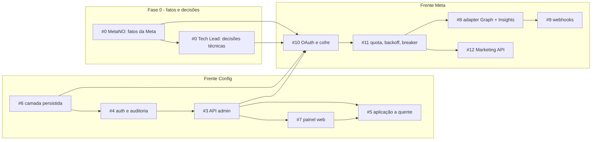

# Plano de entrega — painel de configuração + integração Meta

Versão 1 (consolidação do líder). Repo: `gunsleobezerra/analyticsoviet`, base `main@d1c42dc`.
Documento de coordenação: define ordem, donos e decisões. As especificações por frente são os documentos dos especialistas (`docs/especificacao/painel-config.md` e `docs/especificacao/meta.md`).

## Objetivo

Entregar duas especificações implementáveis sobre a API FastAPI atual:
1. `/admin` — configuração editável pela tela, com precedência banco > ambiente > padrão, segredos protegidos, aplicação a quente do que for seguro e aviso de reinício para o resto.
2. Integração oficial Meta (Graph API + Marketing API) — OAuth com cofre de tokens, Insights de Instagram profissional e Página, Marketing API somente leitura, webhooks e controle de quota, com o scraping atual como fallback.

## Fora de escopo

- Implementação, código de aplicação, build e deploy. Outro agente implementa a partir da especificação.
- Escrita na conta de anúncios (pausar, ajustar orçamento) — issue #12 é somente leitura.
- Instagram pessoal via API oficial (a Meta não expõe; segue scraping).
- Autenticação da API pública `/v1/*` — continua aberta como hoje.
- Alertas por WhatsApp em bloqueio de conta (#11) — vira issue separada, dono Nó, se o Leonardo quiser.
- Substituir o scraping: ele permanece como fallback e para plataformas sem API oficial (TikTok, YouTube por HTML).

## Método

Kanban com limite de trabalho em andamento (uma frente por especialista por vez), porque não há cadência de sprint acordada e o gargalo real é a dependência MetaNO → arquitetura → modelo → revisão. Sem estimativa em pontos; ordem e bloqueio explícitos.

## Divisão e donos

| Item | Dono | Artefato |
|---|---|---|
| Casos de uso e critérios testáveis das duas frentes; requisitos faltantes | Analista de Requisitos | `docs/especificacao/requisitos.md` |
| C4 container/componente, pontos de integração em `src/main.py`/`src/api/deps.py`, config quente/fria, fluxo OAuth, fallback Graph→scraping | Arquiteto de Software | `docs/especificacao/arquitetura.md` |
| Tabelas novas, índices, migração do SQLite atual (hoje só `create_all` em `src/db/session.py`) | Modelador de Dados | `docs/especificacao/modelo-dados.md` |
| Versão da Graph API, permissões por endpoint, tokens e renovação, quota, requisitos de webhook, App Review | MetaNO | `docs/especificacao/meta-fatos.md` |
| Frontend, hash de senha, criptografia de token, versionamento de schema, o que não construir | Tech Lead | `docs/especificacao/decisoes-tecnicas.md` |
| Revisão de tudo, furos e critérios não testáveis | Revisor de Especificação | parecer por documento |
| Consolidação, conflito, ordem, escopo das issues | Líder de Planejamento | este documento |

## Ordem de execução e dependências

Sequência recomendada (uma fila única, para não travar revisão):

1. **Fase 0** — MetaNO publica fatos; Tech Lead fecha as decisões técnicas. Nada de spec de Meta antes disso; nada de modelo de dados antes da decisão de migração.
2. **#6** camada de configuração persistida (base das duas frentes; define precedência, classificação quente/fria e metadados por campo).
3. **#4** autenticação e auditoria (precede qualquer escrita administrativa).
4. **#3** API administrativa de leitura/escrita com validação e segredos mascarados (auditoria de #4 é gravada aqui).
5. **#10** OAuth Meta + cofre de tokens (depende de #6 para a chave de criptografia e de #3 para cadastrar app id/secret pela tela).
6. **#7** painel web e **#5** aplicação a quente, nesta ordem: a tela precisa da API de #3 e o aviso de "exige reinício" depende da classificação de #5.
7. **#11** quota/backoff/breaker da Meta (antes de qualquer volume de chamadas de #8/#12).
8. **#8** adapter Graph + Insights (fallback para scraping) e **#12** Marketing API podem andar em paralelo, mesma base de cliente e limitador.
9. **#9** webhooks, por último: depende de #10 (contas e tokens), #11 (retentativa) e #8 (gravar snapshot com origem).

Regra de merge: cada issue em sua branch `feat/<numero>-<slug>` ou `docs/<numero>-<slug>`, parecer do revisor registrado na issue, merge na `main` só depois do parecer. A ordem acima é também a ordem de merge.

## Decisões fechadas (seção "Aberto" das issues)

Fechadas pelo líder, com base no código; as que dependem de fato externo ficam marcadas.

- **#6 segredos**: guardar no banco criptografados com chave vinda do ambiente (`CONFIG_SECRET_KEY`), não apenas indicar presença no `.env`. Sem a chave, campos sensíveis ficam somente leitura e o painel mostra o motivo. Motivo: o painel precisa cadastrar app secret da Meta; exigir edição de arquivo contradiz o objetivo da frente.
- **#6 histórico de overrides**: fora desta entrega. A auditoria de #4 já guarda valor anterior e novo; rollback automático fica para depois.
- **#5 proxy e timeouts HTTP**: **frios** nesta entrega (exigem reinício). Quentes: 5 TTLs de cache, rate limit e concorrência por plataforma, parâmetros do breaker, user agents, `scrape_max_urls`, `scrape_default_posts`, `enable_ytdlp_fallback`, `log_level`, `public_base_url`, `youtube_api_key` e credenciais Meta. Motivo: recriar `HttpClient` em runtime com requisições em voo é o maior risco de estado misto do escopo.
- **#5 invalidação de cache ao mudar TTL**: limpar as chaves da plataforma afetada, não só passar a usar o TTL novo.
- **#4 usuário**: um único administrador nesta entrega. Senha inicial por variável de ambiente, troca obrigatória no primeiro acesso, hash com a biblioteca que o Tech Lead indicar (recomendação: `argon2-cffi`).
- **#4 TLS**: o serviço fica atrás de proxy reverso (Coolify). Cookie `Secure` sempre em `environment=prod`, confiando em `--proxy-headers` já presente no `CMD` do `Dockerfile`.
- **#7 tema**: layout claro, uma coluna no celular, sem tema escuro. Operador é o Leonardo; textos de ajuda em primeira pessoa do operador, sem jargão.
- **#7 teste de conexão**: apenas leitura e barato — S3 (listar prefixo), Redis (ping), YouTube (1 chamada com a chave), Meta (chamada a `/me` com o token da conta conectada). Nunca testar Meta com app secret.
- **#12 moeda e fuso**: usar os da conta de anúncios e ecoar na resposta (`currency`, `timezone_name`); não forçar `America/Sao_Paulo`. Motivo: forçar fuso muda a fronteira do dia e o gasto deixa de bater com o Gerenciador de Anúncios.
- **#12 resumo padrão**: gasto, impressões, cliques, CTR, CPC, CPM e "resultado" com o tipo de resultado declarado. Conversas iniciadas entram como métrica opcional, por depender do objetivo da campanha.
- **#8 janela padrão de Insights**: 30 dias, com parâmetro explícito; 7 e 28 disponíveis.
- **#9 fila**: em banco, na mesma tabela de eventos, sem nova infraestrutura. Redis já existe no compose, mas uma fila em Redis traria semântica de entrega e perda que o time não vai operar nesta entrega.
- **#9 campos de webhook**: `comments`, `mentions` e `feed` da Página; `comments` e `mentions` do Instagram. `messages` fora (exige permissões de Messenger e revisão adicional).
- **#11 limite**: dinâmico pelo cabeçalho de uso da Meta quando existir, com teto conservador próprio (fração da quota conhecida) como piso de segurança. Percentual exato depende do MetaNO.

Pendente de terceiro (não fechar por suposição):

- **#10/#9/#11/#8** — versão vigente da Graph API, permissões exatas, tipos de token e renovação, limites por app/conta/Página, requisitos de verificação de webhook e necessidade de App Review: **MetaNO**.
- **#8** — se guardar Insights no histórico tem restrição de política: **MetaNO**.
- **#4** — se o Leonardo quer mais de um operador e se o TLS termina no Coolify: **Leonardo**.

## Riscos

| Risco | Impacto | Dono | Mitigação |
|---|---|---|---|
| `WEB_CONCURRENCY` > 1 (uvicorn `--workers`): cada processo tem `lru_cache` e `MemoryCache` próprios | Config "a quente" aplicada em um worker e não nos outros; TTL divergente | Arquiteto | Versão de config no banco consultada por requisição (barata, com cache curto) ou pub/sub no Redis; critério de aceite de #6 já exige convergência entre workers |
| Sem Alembic: schema só por `create_all` | Tabelas novas em banco existente não são criadas; migração de colunas quebra | Tech Lead + Modelador | Decidir versionamento de schema na Fase 0 e incluir migração na issue que cria as tabelas |
| SQLite com escritas novas (config, auditoria, eventos de webhook) e concorrência | `database is locked` sob carga | Modelador | WAL, transações curtas, fila em tabela com índice; medir no teste de concorrência de #5 |
| Segredo em log, auditoria ou resposta de erro | Vazamento de token Meta | Analista + Revisor | Critério de aceite explícito em #3, #4, #10 e #11; teste que varre log e dump |
| App Review demorado ou negado | Integração pronta e não utilizável em produção | MetaNO + Leonardo | MetaNO diz o que exige revisão; se exigir, a entrega inclui o roteiro de submissão e o modo "app em desenvolvimento" com contas de teste |
| Queda da Graph API ou token revogado | Métricas faltando | Arquiteto | Fallback Graph→scraping já previsto em #8, com `source` e `warnings` no snapshot |
| Painel exposto sem TLS | Senha e tokens em trânsito | Leonardo | #4 exige `Secure` em prod; confirmar terminação TLS antes de publicar `/admin` |

## Pendências de escopo que precisam de decisão do Leonardo

1. `/admin` fica no mesmo host público da API ou em porta/host separado? (afeta exposição e TLS)
2. Uma conta Meta por plataforma ou várias contas/Páginas por instância? (afeta modelo e tela)
3. Marketing API já nesta entrega ou depois do orgânico estabilizar? (é a issue #12; hoje está no épico #1)

## Próximo passo

Fase 0: MetaNO publica os fatos e o Tech Lead fecha as decisões técnicas. Em paralelo, Analista, Arquiteto e Modelador produzem a especificação de #6 (a base das duas frentes) para o revisor dar o primeiro parecer.
