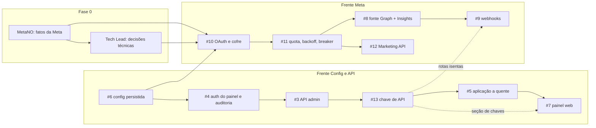

# Plano de entrega — painel de configuração + integração Meta + autenticação da API

Versão 2. Repo: `gunsleobezerra/analyticsoviet`, base `main@d1c42dc`.
Documento de coordenação: define escopo, ordem, donos, dependências e decisões. As especificações por frente estão em `docs/especificacao/`.

Mudança da v1 para a v2: entra a issue **#13 (autenticação da API pública)**, o escopo de autenticação de `/v1` deixa de ser "fora de escopo", a janela de Insights e a lista de campos de webhook são fechadas, e as especificações dos especialistas passam a ser versionadas neste repositório.

## Objetivo

Entregar três especificações implementáveis sobre a API FastAPI atual:
1. `/admin` — configuração editável pela tela, com precedência banco > ambiente > padrão, segredos cifrados, aplicação a quente do que for seguro e aviso de reinício para o resto.
2. Integração oficial Meta (Graph API + Marketing API) — OAuth com cofre de tokens, Insights de Instagram profissional e Página, Marketing API somente leitura, webhooks e controle de quota, com o scraping atual como fallback.
3. `/v1/*` — autenticação por chave de API, separada da sessão do painel.

## Fora de escopo

- Implementação, código de aplicação, build e deploy. Outro agente implementa a partir da especificação.
- Escrita na conta de anúncios (pausar, ajustar orçamento) — #12 é somente leitura.
- Instagram pessoal via API oficial (a Meta não expõe; segue scraping).
- OAuth2/JWT, IP allowlist por chave, multi-tenant, RBAC/multi-usuário, 2FA.
- Alertas por WhatsApp em bloqueio de conta (#11) — issue separada, dono Nó, se o Leonardo quiser.
- Substituir o scraping: ele permanece como fallback e para plataformas sem API oficial.

## Método

Kanban com WIP 1 por especialista, porque não há cadência de sprint acordada e o gargalo é a cadeia MetaNO → arquitetura → modelo → revisão. Sem estimativa em pontos; ordem e bloqueio explícitos.

## Divisão e donos

| Item | Dono | Artefato |
|---|---|---|
| Casos de uso e critérios testáveis | Analista de Requisitos | `docs/especificacao/requisitos/` |
| C4, integração em `src/main.py`/`src/api/deps.py`, config quente/fria, OAuth, fallback | Arquiteto de Software | `docs/especificacao/arquitetura/` |
| Tabelas, índices, migração do SQLite atual | Modelador de Dados | branch `dados/modelo-config-meta`, `04-dados/` |
| Versão da Graph API, permissões, tokens, quota, webhook, App Review | MetaNO | `docs/especificacao/meta-fatos.md` |
| Frontend, hash de senha, criptografia, versionamento de schema, o que não construir | Tech Lead | `docs/especificacao/decisoes-tecnicas.md` |
| Revisão de tudo | Revisor de Especificação | branch `revisao/especificacao-config-meta` |
| Consolidação, conflito, ordem, escopo das issues | Líder de Planejamento | este documento |

## Ordem de execução e dependências

Sequência recomendada (fila única, para não travar revisão):

1. **Fase 0** — MetaNO publica os fatos; Tech Lead fecha as decisões técnicas.
2. **#6** camada de configuração persistida e runner de migração.
3. **#4** autenticação e auditoria do painel.
4. **#3** API administrativa com validação e segredos mascarados.
5. **#13** chave de API: backend + CLI primeiro; seção do painel depois de #7.
6. **#5** aplicação a quente, com os limites por chave já existentes.
7. **#7** painel web, incluindo o item de navegação de chaves.
8. **#10** OAuth Meta + cofre de tokens.
9. **#11** quota, backoff e breaker por conta.
10. **#8** fonte Graph + Insights e **#12** Marketing API em paralelo.
11. **#9** webhooks.

Merge na `main` só com parecer do revisor, na mesma ordem.

## Decisões fechadas

### Configuração e painel (#3–#7)

- Precedência banco > ambiente > padrão. Segredos cifrados no banco (AES-256-GCM, chave `APP_ENCRYPTION_KEY` só no ambiente e `read_only` no painel); sem a chave, escrita de segredo é recusada.
- Frio (exige reinício): `database_url`, `api_prefix`, `environment`, `cache_backend`, `redis_url`, backend e caminhos de cookies, `proxy_url`, timeouts e conexões HTTP, `public_base_url`, `API_AUTH_ENABLED`, `MCP_ENABLED`.
- Quente: 5 TTLs de cache, rate limit e concorrência por plataforma, limites por chave de API, breaker, user agents, `scrape_max_urls`, `scrape_default_posts`, `enable_ytdlp_fallback`, `log_level`, `youtube_api_key` e credenciais Meta.
- TTL já gravado não encurta: epoch por família de TTL nas chaves de cache (o cache atual não lista chaves, então "limpar chaves" não é implementável).
- Um operador; senha inicial por ambiente, hash Argon2id no banco, troca pela tela.
- `/admin` e `/admin/api` fora de `api_prefix`, no mesmo domínio, fora do OpenAPI público, assets locais sem CDN.

### API pública (#13)

- Chave por integração, nome identifica; sem chave global. `avk_` + 32 bytes, guardado só SHA-256 + prefixo.
- Escopos `read:metrics`, `write:scrape`, `admin`; sem OAuth2/JWT nesta fase.
- Rotas isentas: `/v1/health` (healthcheck), `GET /v1/meta/oauth/callback`, `POST /v1/meta/webhook`. `/v1/system/status` autenticado com `read:metrics`.
- Revogação vale na requisição seguinte: leitura do banco por requisição, `last_used_at` no máximo 1×/min.
- Limite por chave: 120 req/min leitura, 30 req/min scraping; contador no cache, nunca escrita por requisição no SQLite.
- `/mcp` desligado por padrão; ligado, exige a mesma chave.
- `API_AUTH_ENABLED` é frio: desligar autenticação não pode valer a quente.

### Meta (#8–#12)

- `source="official_api"` + `extra.provider="meta_graph"`; `confidence` alto. Nenhum valor novo no enum de `source`.
- Fonte Graph injetada no `AdapterContext`; o registry continua `{Platform: adapter}`. Não criar segundo adapter.
- Insights em formato longo, ausência = linha ausente, nunca zero. Janela padrão **28 dias**, com 7 e 30 disponíveis.
- Webhooks: Página com `feed`, `comments`, `mentions`; Instagram com `comments`, `mentions`. `messages` fora.
- Fila em tabela SQLite, worker único com lock de líder, idempotência por `dedupe_key`.
- Quota: bucket e breaker por conta, não por plataforma. Erro oficial não substitui scraping disponível — cliente recebe 200 com warning.
- Marketing API só GET, campos explícitos, moeda e fuso da conta ecoados, nunca convertidos.

## Riscos

| Risco | Impacto | Dono | Mitigação |
|---|---|---|---|
| `WEB_CONCURRENCY` > 1: cada worker tem `lru_cache` e `MemoryCache` próprios | Config quente aplicada em um worker só | Arquiteto | Versão em `config_state`, comparação periódica; teste com 2 workers |
| Sem migração versionada (`create_all` em `src/db/session.py`) | Tabela nova não aparece em produção | Tech Lead + Modelador | Runner SQL na #6, antes de qualquer tabela nova |
| SQLite recebe escritas novas (config, auditoria, chaves, webhook) | `database is locked` | Modelador | WAL, `busy_timeout`, transações curtas; contadores fora do banco |
| `API_AUTH_ENABLED=true` sem chave criada | n8n/Make/scripts param no deploy | Leonardo | Subir com `false`, criar chaves, ligar `true` com restart |
| `enable_history=false` impede o banco de subir | Config e cofre de tokens param | Arquiteto | Banco sempre no boot; só a gravação de histórico atrás da flag |
| Segredo em log, auditoria ou erro | Vazamento de token Meta | Revisor | Critério explícito em #3, #4, #10, #11, #13 |
| App Review negado ou demorado | Integração pronta e inutilizável | MetaNO + Leonardo | MetaNO diz o que exige revisão; roteiro de submissão |
| Painel exposto sem TLS | Senha e tokens em trânsito | Leonardo | `Secure` em prod; confirmar terminação TLS |

## Pendências de terceiros

- **MetaNO:** versão da Graph API, permissões por endpoint, tipos e renovação de token, quota, verificação e assinatura de webhook, App Review, restrição de guardar Insights.
- **Leonardo:** `/admin` no mesmo host ou separado; uma conta Meta por plataforma ou várias; Marketing API nesta entrega ou depois; TLS/Coolify; retenção de dados; multi-cliente.

## Próximo passo

Fase 0 com MetaNO e Tech Lead; em paralelo, a especificação da #6 vai para o revisor, porque ela destrava a fila inteira.
